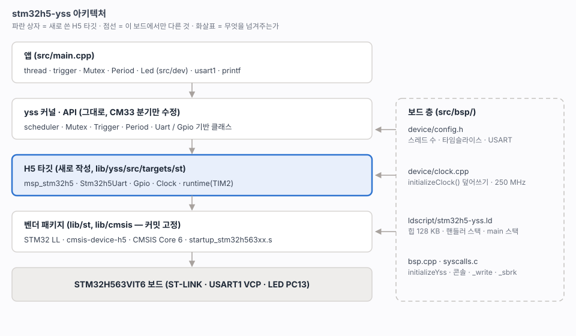

# 12. 프로젝트 구조와 빌드

> `firmware/stm32h5-yss` 의 디렉터리, yss 를 붙이는 방식, 메모리 배치, VSCode. 참조 프로젝트(FRDM-IMXRT1186)의 구조를 따르고 yss 에 맞게 바꾼 부분만 적는다.
> 관련: [04-yss-structure.md](04-yss-structure.md) · [11-sdk-vendoring.md](11-sdk-vendoring.md) · [20-yss-kernel.md](20-yss-kernel.md)



---

## 1. 디렉터리

```
firmware/stm32h5-yss/
├── CMakeLists.txt              CPU 옵션, yss_vendor, yss 서브디렉터리, 앱
├── .clang-format  .gitignore
├── .vscode/                    c_cpp_properties · extensions
├── prj/                        VSCode 워크스페이스 (태스크 · 디버그 구성 포함)
├── tools/
│   ├── arm-none-eabi-gcc.cmake 툴체인 (참조 프로젝트와 같다)
│   ├── flash.cmake             probe-rs 기록 타깃
│   ├── fetch_st_sdk.py         벤더 파일 가져오기 (11장)
│   └── svd/                    (저장소 밖) setup_tools.py 가 채운다
├── lib/                        외부 코드 — 고치지 않는다 (yss 는 포크에서 고친다)
│   ├── yss/                    서브모듈: chcbaram/yss, cmake-h5 브랜치
│   ├── st/                     cmsis-device-h5, LL (SOURCES.md)
│   └── cmsis/                  CMSIS 6 Core
└── src/                        이 프로젝트의 코드
    ├── main.cpp                bspInit → 트리거 1 · 스레드 2
    ├── dev/                    보드 장치 — yss 제작자 예제의 common/dev 와 같은 형태
    │   ├── led.h               namespace Led (initialize, set). #include <dev/led.h>
    │   ├── console.h           namespace Console (initialize, write, getByte, waitUntilReceive)
    │   └── driver/
    │       ├── dev_led.cpp     PC13, active low
    │       └── dev_console.cpp USART1 PA9/PB7, _write, debug_printf
    └── bsp/
        ├── bsp.h  bsp.cpp      initializeYss → Console::initialize → Led::initialize
        ├── syscalls.c          _sbrk (힙 경계), newlib 스텁
        ├── device/
        │   ├── config.h        yss 설정 (YSS_CONFIG_DIR)
        │   └── clock.cpp       initializeClock() — 250 MHz
        └── ldscript/
            └── stm32h5-yss.ld
```

외부 코드는 `lib/` 한 곳에 둔다. `src/` 에는 이 프로젝트에서 쓴 코드만 있다.

### yss 제작자 예제와의 대응

제작자의 최신 예제(NuMaker-M251KG_example, nRF52840-DK_example, 2026)와 같은 짜임이다.

| 제작자 예제 | 이 프로젝트 | 다른 점 |
|---|---|---|
| `app/src/bsp.cpp` `initializeBoard()` | `src/bsp/bsp.cpp` `bspInit()` | `initializeYss()` 를 main 이 아니라 `bspInit()` 첫 줄에서 부른다 |
| `common/dev/led.h` `namespace Led` | `src/dev/led.h` `namespace Led` | 같다. 구현은 `src/dev/driver/` 에 둔다 |
| LED 표시는 `trigger::run()` 으로 20 ms 깜빡임 | `trigger_blinkLed` 50 ms | 같은 방식 |
| AF 는 이름 상수 `Gpio::PB12_UART0_RXD` | 번호 `Gpio::AF7` | H5 용 이름 표는 아직 없다 |
| 디버그 출력은 `debug_printf()` → SEGGER IDE 디버그 터미널 | `Console` 장치 (`src/dev`): printf · `debug_printf` → USART1 | 제작자 예제에는 콘솔 장치가 없다. GCC 에는 SEGGER 터미널이 없어 UART 로 대신한다 |
| UART 는 앱이 `uart0` 를 직접 쓴다 | 앱은 `Console::write` / `getByte` | |

## 2. yss 를 붙이는 방식

yss 는 `yss` 라는 정적 라이브러리 하나를 만든다(`lib/yss/CMakeLists.txt`). 앱은 다섯 가지를 넘긴다.

| 값 | 이 프로젝트 | 뜻 |
|---|---|---|
| `YSS_TARGET` | `stm32h5` | `cmake/targets/stm32h5.cmake` 를 고른다 (`src/targets/st` 를 더한다) |
| `YSS_MCU` | `STM32H563xx` | 품번 매크로. `mcu.h` 가 `STM32H5`, `YSS__CORE_CM33_H_GENERIC` 로 바꾼다 |
| `YSS_CONFIG_DIR` | `src/bsp/device` | `<config.h>` 를 찾는 곳. config.h 만 있는 폴더라 다른 헤더가 yss 에 새지 않는다 |
| `YSS_HEAP_SIZE` | `0x20000` | yss 의 `__HEAP_SIZE__`. 링커 스크립트 `_Min_Heap_Size` 와 같아야 한다 |
| `yss_vendor` | INTERFACE 타깃 | 벤더 include 경로, `-mcpu` 등 CPU 옵션, `HSE_VALUE` |

SEGGER 가 해 주던 것은 yss 소스를 고치지 않고 CMake 정의로 맞춘다.

| SEGGER 가 하던 것 | CMake 에서 |
|---|---|
| `__HEAP_SIZE__` 자동 정의 | `__HEAP_SIZE__=${YSS_HEAP_SIZE}` |
| `<__cross_studio_io.h>` | `__SEGGER_LINKER` 를 정의해 `debug.h` 가 `debug_printf` 선언만 하게 하고, 함수는 `bsp.cpp` 에 둔다 |
| 소문자 `.s` 전처리 | `-x assembler-with-cpp` |
| 프로세스 스택 준비 | **CMake 로는 안 된다.** H5 msp 가 한다 ([20](20-yss-kernel.md) 2절) |

공통 소스는 전부 glob 하고 `#if` 로 걸러진다. `src/targets/<vendor>` 만 타깃 파일이 더한다.

### 컴파일 옵션

| 옵션 | 이유 |
|---|---|
| `-mcpu=cortex-m33 -mfpu=fpv5-sp-d16 -mfloat-abi=hard` | H563 은 단정도 FPU |
| `-fno-exceptions -fno-rtti -fno-threadsafe-statics` (C++) | yss 는 예외와 RTTI 를 쓰지 않는다 |
| `-Og -g3` | 디버그 우선. yss 스케줄러는 자체 `#pragma GCC optimize("O1")` 이 있다 |
| 벤더 `.c` 만 `-Os -w` | 프로젝트 코드의 경고를 가리지 않게 |
| `-specs=nano.specs` (nosys 없음) | 시스템 콜은 `syscalls.c` 에서 직접 만든다 |

## 3. 메모리 배치

링커 스크립트는 우리가 소유한다(`src/bsp/ldscript/stm32h5-yss.ld`). ST 스크립트는 `lib/st/device/gcc/*.ref` 로 참고만 한다.

| 영역 | 주소 | 크기 | 쓰임 |
|---|---|---|---|
| FLASH | `0x0800_0000` | 2 MB | 벡터, 코드, 상수 (현재 14.0 KB) |
| `.data` `.bss` | `0x2000_0000` | 1.2 KB | |
| `.heap` | `0x2000_04C8` | **128 KB** | `malloc` / `new`. **스레드 스택도 여기서 받는다** |
| `.handler_stack` | `0x2002_04C8` | 2 KB | MSP — 인터럽트와 예외 |
| main 스택 | `0x2009_F000` ~ `0x200A_0000` | 4 KB | 리셋 후 시작 스택. main 전에 PSP 로 넘겨 main 스레드가 쓴다 |

그림은 [20](20-yss-kernel.md) 맨 위.

- `_sbrk` 는 `_sheap` ~ `_eheap` 를 넘지 않는다. 넘으면 `ENOMEM` 을 돌려주고, `thread::add()` 는 스택 할당 실패로 끝난다(`debug_printf` 로 알린다).
- `.bss + .heap + .handler_stack` 이 main 스택 바닥(`_sstack`)을 넘으면 링크가 실패한다(`ASSERT`).

## 4. 빌드 타깃

| 명령 | 결과 |
|---|---|
| `cmake -S . -B build -G Ninja && cmake --build build` | `build/stm32h5-yss.{elf,bin,hex,map}`, `compile_commands.json` |
| `cmake --build build --target flash` | probe-rs 로 elf 기록 (`--verify`) 후 리셋 |

## 5. VSCode

`prj/stm32h5-yss.code-workspace` 를 연다. 참조 프로젝트와 같이 **태스크와 디버그 구성을 워크스페이스 파일 안에 둔다.** 워크스페이스 파일의 launch 는 `preLaunchTask` 를 같은 파일의 `"tasks"` 에서만 찾기 때문이다.

| 태스크 | 하는 일 |
|---|---|
| `build-configure` | `cmake -S . -B build -G Ninja` |
| `build-build` (기본, `Cmd+Shift+B`) | configure 후 빌드 |
| `build-clean` | clean |
| `flash` | 빌드 후 probe-rs 기록 |

| 디버그 구성 | 동작 |
|---|---|
| **Debug (probe-rs)** | `build-build` → 기록(검증) → 리셋 후 멈춤. 브레이크포인트를 걸고 F5 |
| **Attach (probe-rs)** | 기록하지 않고 돌고 있는 코어에 붙는다 |

SVD 는 `tools/svd/STM32H563.svd` (주변장치 레지스터 뷰). IntelliSense 는 `build/compile_commands.json` 을 쓴다.

## 확인 필요

- VSCode 디버그 구성은 파일만 만들었다. 이 세션에서 F5 로 실제 실행해 보지는 않았다(같은 구성을 참조 프로젝트에서 쓰고 있다).
