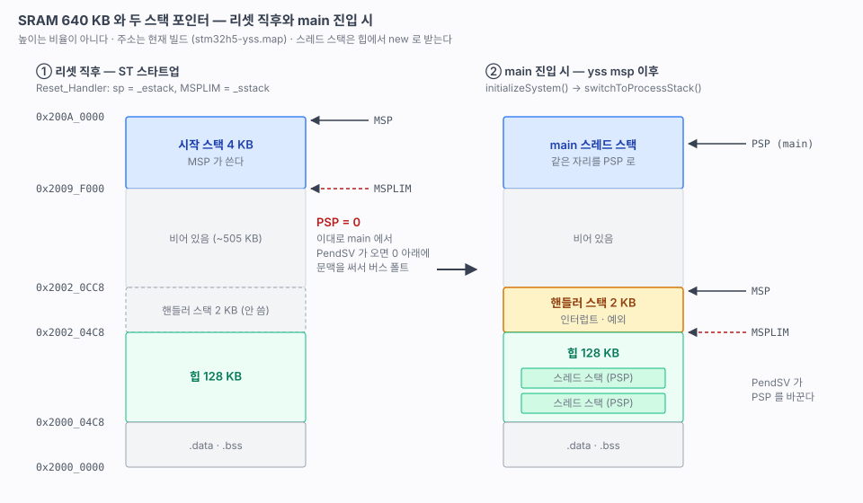

# stm32h5-yss 펌웨어 문서

STM32H563VIT6 커스텀 보드(STM32H5_ETH_CAN485)에서 yss OS 를 커널 구조 그대로 쓰면서, SEGGER Embedded Studio 대신 gcc + CMake + Ninja + probe-rs 로 빌드하는 프로젝트의 기록.


## 현재 상태 (2026-10-11)

| | |
|---|---|
| 보드 | STM32H5_ETH_CAN485 Rev 1 · MCU `STM32H563VIT6` (LQFP100, 2 MB / 640 KB) |
| 디버거 | ST-LINK V2-1 (J2: SWD + USART1) · probe-rs 0.32 |
| 펌웨어 | `firmware/stm32h5-yss` — **yss 스레드 · trigger · Mutex · Period · UART 송수신 · 250 MHz** |
| yss | 서브모듈 `lib/yss` = [chcbaram/yss](https://github.com/chcbaram/yss) `cmake-h5` 브랜치 (Release/2026.09 + 커밋 4개) |
| 벤더 | cmsis-device-h5 / stm32h5xx-hal-driver v1.7.0 (LL 만), CMSIS 6.4.0 — 30개 파일, 커밋 고정 ([11](11-sdk-vendoring.md)) |
| 빌드 | FLASH 14.0 KB · RAM 131 KB (대부분 힙 128 KB) |
| 콘솔 | USART1 → ST-LINK VCP · 115200 8N1 · baram-term `--match STLink` |

### 바로 다시 시작하기

```bash
python3 tools/setup_tools.py              # 도구 점검 + 서브모듈 + SVD (새 PC 에서 처음 한 번)

cd firmware/stm32h5-yss
cmake -S . -B build -G Ninja
cmake --build build
cmake --build build --target flash        # 콘솔에 1 초마다 count 출력, 그때마다 LED(PC13) 50 ms 깜빡임

# 콘솔: baram-term 으로 STM32 STLink 포트 115200 → 배너 + "count N, M ms"
```

VSCode 는 `firmware/stm32h5-yss/prj/stm32h5-yss.code-workspace` 를 연다. 디버그는 **Debug (probe-rs)**.

### 다음 작업

1. **yss 포크 push** — `cmake-h5` 와 `archive/*` 브랜치는 아직 로컬에만 있다 ([04](04-yss-structure.md) 4절)
2. **23 스레드 스택 한계** — PendSV 에서 PSPLIM 을 스레드마다 바꿔 스택 넘침을 하드웨어로 잡는다
3. **24 EXTI · 버튼(S5, PC0)** — 지금은 `YSS_DRV_EXTI_UNSUPPORTED`

### 미해결 과제

| 과제 | 왜 중요한가 | 언제 |
|---|---|---|
| PSP 전환의 위치 | GCC 스타트업으로 yss 를 쓰는 모든 타깃에 필요하다. 지금은 H5 msp 에만 있다 ([20](20-yss-kernel.md) 2절) | 원저자 PR 전 |
| UART 송신이 폴링 | 긴 출력 중에는 그 스레드가 타임슬라이스를 다 쓴다 | 25 (GPDMA) |
| VSCode 디버그 미실행 | 구성만 만들었다 ([12](12-project-skeleton.md) 5절) | 다음 세션 처음 |
| Windows / Linux 미검증 | macOS 에서만 돌렸다 | 다른 PC 를 쓸 때 |

## 문서 번호 규칙

| 대역 | 성격 |
|---|---|
| `00~09` | 하드웨어 · yss 레퍼런스. 원문(회로도, 소스, git 기록)에서 확인한 사실 |
| `10~19` | 개발 환경과 프로젝트 구조 |
| `20~29` | 기반 기능 — 기능 하나당 문서 하나. "무엇을 왜 + 막혔던 지점 + 검증 방법" |
| `30~39` | 주변장치 |
| `50~59` | 네트워크 |

확인하지 못한 것은 확인하지 못했다고 적는다. 각 문서 끝의 "확인 필요" 에 남긴다.

## 목차

### 레퍼런스

| 문서 | 내용 | 상태 |
|---|---|---|
| [03-board-mapping](03-board-mapping.md) | MCU, 클럭 소스, 디버그 커넥터, LED/콘솔 핀, 나머지 주변장치 넷 | ✅ |
| [04-yss-structure](04-yss-structure.md) | yss 계층, MCU 선택 흐름, STM32 코드가 사라진 이유, 2026.09 변경, `Period` | ✅ |

### 환경과 구조

| 문서 | 내용 | 상태 |
|---|---|---|
| [10-dev-environment](10-dev-environment.md) | 도구, probe-rs 를 고른 이유, 저장소 밖 자산 | ✅ (macOS 만 검증) |
| [11-sdk-vendoring](11-sdk-vendoring.md) | ST 파일 고정 방식과 목록, 받지 않은 것 | ✅ |
| [12-project-skeleton](12-project-skeleton.md) | 디렉터리, yss 를 붙이는 방식, 메모리 배치, VSCode | ✅ |

### 로드맵

| 번호 | 내용 | 상태 |
|---|---|---|
| [20](20-yss-kernel.md) | **yss 커널 on CM33** — PSP 전환, MSPLIM, 초기 EXC_RETURN, CM33 분기 | ✅ |
| [21](21-clock.md) | **클럭** — HSE 25 MHz → PLL1 250 MHz, runtime TIM2 1 MHz | ✅ |
| [22](22-uart-console.md) | **GPIO · USART · 콘솔** — LL 드라이버, printf, baram-term, 921600 | ✅ |
| 23 | 스레드 스택 한계 (PSPLIM) · 스택 사용량 | 예정 |
| 24 | EXTI · 버튼 (S5 PC0) | 예정 |
| 25 | GPDMA · UART TX DMA | 예정 |
| 30 | SPI (신형, H7 계열) · W25Q256 | 예정 |
| 31 | I2C · FRAM (FM24C16B) · OLED | 예정 |
| 32 | FDCAN ×2 | 예정 |
| 33 | RS485 · LIN · RS232 (USART 여러 개, DE 핀) | 예정 |
| 34 | SDMMC · microSD | 예정 |
| 35 | USB-C (FS 디바이스) | 예정 |
| 50 | Ethernet (LAN8742A RMII) | 예정 |

### 순서 근거

- **커널 → 클럭 → 콘솔을 먼저 했다.** 이후 모든 검증이 콘솔 로그로 바뀐다. 실제로 두 번째 폴트(MSPLIM)는 콘솔 수신에서 드러났다.
- **스택 한계(23)를 주변장치 앞에 둔다.** 스레드 스택은 힙에서 받으므로 넘치면 다른 스레드의 스택을 조용히 덮는다. 주변장치가 늘기 전에 하드웨어로 잡아 둔다.
- **DMA(25)를 SPI 앞에 둔다.** H5 의 GPDMA 는 링크드 리스트 구조로 예전 STM32 DMA 와 완전히 다르다. SPI · UART · SDMMC 가 모두 기대므로 먼저 세운다.

## 그림

| 그림 | 문서 |
|---|---|
|  | [12](12-project-skeleton.md) 아키텍처 |
|  | [20](20-yss-kernel.md) SRAM 과 두 스택 포인터 |

그림은 전부 손으로 쓴 SVG 다. 아래 두 스크립트로 검사한다(참조 프로젝트에서 가져왔다).

```bash
python3 firmware/docs/check_svg.py      # 글자 겹침 · 박스 이탈
python3 firmware/docs/check_links.py    # 상대 링크 · 앵커
```

## 출처

| 자료 | 위치 |
|---|---|
| 보드 회로도 STM32H5_ETH_CAN485 Rev 1 | `hardware/stm32h5_kit.pdf` |
| yss 원본 · 포크 | [mymy49/yss](https://github.com/mymy49/yss) · [chcbaram/yss](https://github.com/chcbaram/yss) |
| 이전 세션 인수인계 문서 | Claude Docs "yss OS × STM32H5 커스텀 보드 CMake 프로젝트 인수인계" |
| ST 벤더 파일 | `firmware/stm32h5-yss/lib/st/SOURCES.md` |

### 아직 없는 자료

- STM32H563 Reference Manual (RM0481) · 데이터시트 (DS14258) — 저장소 밖 `hardware/ref/` 에 둘 자리. 지금 문서의 레지스터 값은 LL 헤더와 CubeMX 결과에서 가져왔다
- LAN8742A · TJA1051 · W25Q256 데이터시트 (각 단계에서)

## 참조한 기존 프로젝트

| 저장소 | 가져온 것 |
|---|---|
| FRDM-IMXRT1186 | 문서 번호 대역과 형식, `check_*.py`, 툴체인 · `flash.cmake`, 워크스페이스 안의 태스크/디버그 구성, `setup_tools.py`, 벤더 파일 고정 스크립트 |
| stm32h5-w6300 | H563 250 MHz 클럭 설정값 (CubeMX 생성) |
